  

  <a href="https://brooklynd23.vercel.app">Portfolio</a> · <a href="https://www.linkedin.com/in/dannyt11">LinkedIn</a> · <a href="https://github.com/BrooklynD23">GitHub</a>

### About

Hey! I'm Danny, a CS and DS student at Cal Poly Pomona with an interest in AI and Biotech.  
On the side, I take photos for a hobby, feel free to check out [my page](https://brooklynd23.vercel.app).

### Featured

<!-- FEATURED:START -->
- **[HealthCentral](https://github.com/BrooklynD23/HealthCentral)**: Local-first Health-Dashboard overview with Local LLM as explanatory agents catered to helping user understands their bio-marker readings. · `Python`
- **[DIGITAL_WebsiteV1](https://github.com/BrooklynD23/DIGITAL_WebsiteV1)**: No description yet. · `HTML`
- **[shoppilot](https://github.com/BrooklynD23/shoppilot)**: ShopPilot+: AI operations agent for small online shops. You approve every dollar. \(CS4680 A4\) · `Python`
<!-- FEATURED:END -->

The sky follows the time of day in Los Angeles, the meadow gets a new cast daily, and Featured tracks my latest pushes, all via <a href=".github/workflows/meadow.yml">GitHub Actions</a>.

